# VigieFS — supervision et administration de serveurs de fichiers

Console web de **supervision, d'administration et de prévention** pour les dossiers et
partages de fichiers de vos clients, dans l'esprit du *Gestionnaire de ressources du
serveur de fichiers* (FSRM) de Windows Server, mais pensée **multi-clients** pour une
société d'infogérance. Elle complète Datto (sauvegarde / RMM) sans le remplacer.

Tout-en-un pour les serveurs de fichiers Windows (NTFS/SMB) et Linux (ACL POSIX/Samba) :
supervision, **droits d'accès et matrice AGDLP**, **architecture et chemins trop longs**,
**quotas stricts**, optimisation du stockage, réparation de documents. Conçu pour tourner
**24 h/24, 7 j/7** : il ne s'arrête que sur décision.

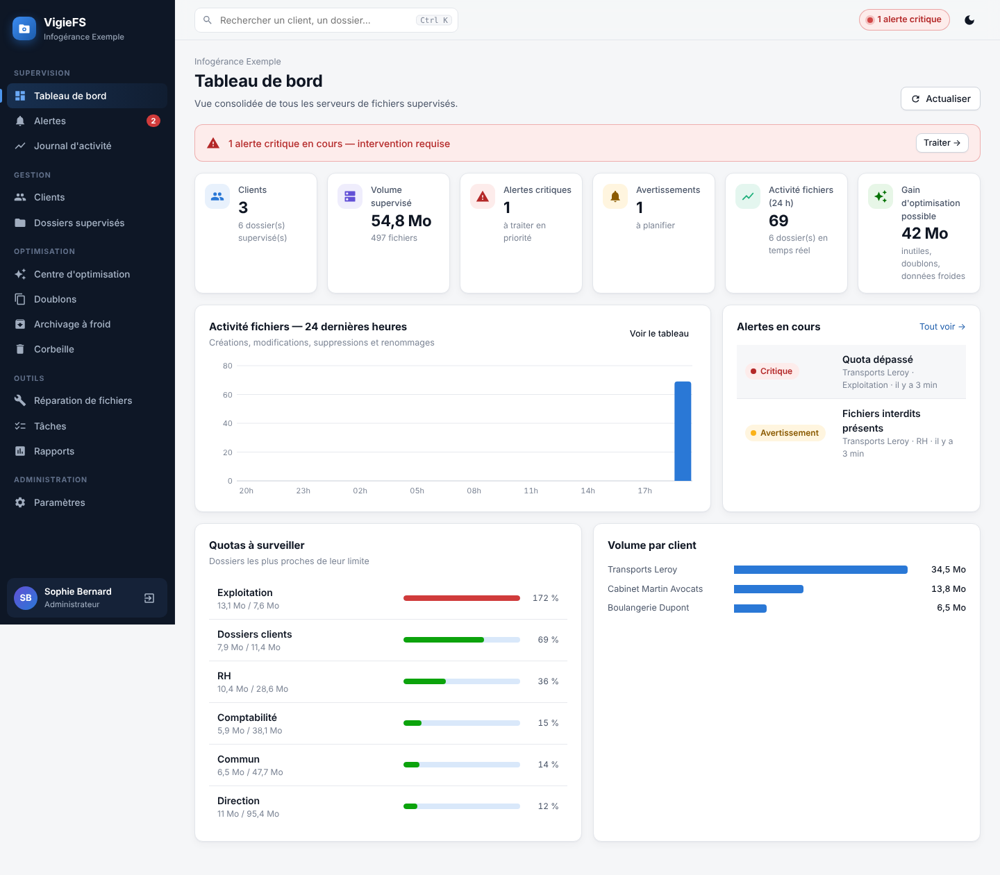

## Fonctionnalités

### Fonctionnement 24 h/24, 7 j/7
| Mécanisme | Ce que fait VigieFS |
|---|---|
| **Superviseur** | `python -m vigiefs supervise` lance le moteur et le **relance en quelques secondes** s'il s'arrête (plantage), se **bloque** (plus de battement de cœur pendant 5 min, piles des threads capturées) ou si l'interface ne répond plus (4 sondes HTTP). Délai progressif 1 s → 60 s, **sans limite de tentatives** : VigieFS revient seul dès que la cause disparaît (réseau, disque, base restaurée). |
| **Service système** | Service Windows (WinSW ou NSSM) avec **actions de récupération** et **démarrage automatique différé**, ou unité systemd (`Restart=on-failure`, chien de garde `WatchdogSec`, `Type=notify`). Sans service : tâche planifiée + **tâche de garde** toutes les 5 min. |
| **Auto-réparation** | Garde interne toutes les 10 s : planificateur, observateur de fichiers, écriture du journal et surveillance de chaque dossier **relancés à chaud**, sans coupure ; alerte « Composant relancé ». |
| **Réseau** | Accès aux partages sondé avec un **délai maximal** (20 s) : un NAS ou un partage UNC figé ne bloque ni le démarrage ni le planificateur ; la surveillance reprend seule au retour du partage. |
| **Base de données** | Point de contrôle WAL horaire, **contrôle d'intégrité et sauvegarde en ligne quotidiens** (7 copies), restauration en une commande (`restore-db`). |
| **Ressources** | Alerte d'espace disque des données ; au-delà de la limite mémoire, **redémarrage propre planifié** dès qu'aucune tâche ne tourne. |
| **Après un incident** | Alerte « VigieFS a redémarré automatiquement » avec la cause, tâches interrompues signalées (celles qui modifient fichiers ou droits sont à vérifier), analyses planifiées reprises. |
| **Arrêt volontaire uniquement** | Bouton *Arrêter* (confirmation « ARRÊTER »), `python -m vigiefs stop`, `Stop-Service VigieFS` ou `systemctl stop vigiefs` : arrêt propre, **journalisé** (qui, quand, pourquoi) et jamais relancé automatiquement. |
| **Mode maintenance** | Suspend pour une durée donnée les actions planifiées et les alertes de disponibilité (Datto reste au vert) ; temps réel et anti-rançongiciel restent actifs. |
| **Disponibilité** | Écran *Service & disponibilité* : état des composants, **disponibilité 7 / 30 jours** (seules les coupures subies comptent), journal des démarrages, incidents, relances, réparations et arrêts. |

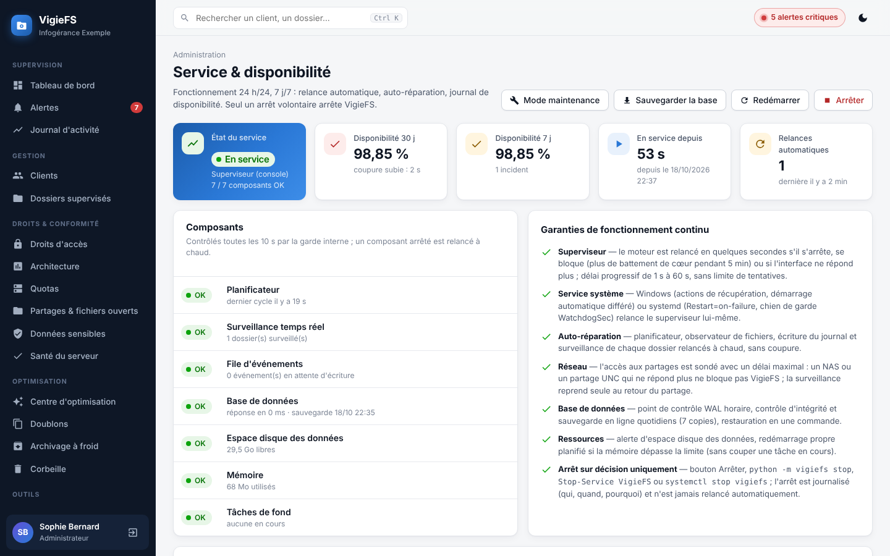

### Supervision
| Domaine | Ce que fait VigieFS |
|---|---|
| **Multi-clients** | Clients → dossiers supervisés (chemins locaux `D:\…` ou UNC `\\SRV\partage`). Vue consolidée, recherche globale (Ctrl K). |
| **Quotas** | Quota par dossier, seuils d'avertissement / critique, **prévision de saturation** (tendance sur 30 jours) ; quotas stricts et par sous-dossier ci-dessous. |
| **Anti-rançongiciel** | Détection temps réel des extensions chiffrées, des notes de rançon et des **rafales de modifications** → alerte critique immédiate. |
| **Filtrage de fichiers** | Extensions interdites, alerte ou **quarantaine** automatique. |
| **Journal d'activité** | Créations, modifications, suppressions, renommages en temps réel, export CSV. |
| **Alertes** | Dédoublonnées, escalade, acquittement, résolution automatique ; e-mail (SMTP) et webhook signé HMAC. |

### Droits d'accès et matrice
| Domaine | Ce que fait VigieFS |
|---|---|
| **Relevé complet des ACL** | NTFS (`Get-Acl` : masques, héritage, portée, propriétaire, refus, SID résolus) et POSIX (`getfacl` : ACL d'accès et par défaut), sur la profondeur choisie. Historique des relevés et **dérive** entre deux analyses. |
| **Audit** | Écriture / lecture ouverte à « Tout le monde » / « Utilisateurs authentifiés », **droits nominatifs** (hors modèle AGDLP), **SID orphelins**, refus explicites, contrôle total hors administrateurs, SYSTEM / administrateurs absents, ruptures d'héritage, ACL explicites trop profondes, ACL surchargées, droits spéciaux, propriétaire orphelin → **score des droits sur 100**. |
| **Qui a accès à quoi ?** | Accès effectifs d'un utilisateur ou d'un groupe (appartenances AD / POSIX résolues, refus pris en compte) sur toute l'arborescence. |
| **Matrice de droits** | Grille dossiers × identités éditable (niveaux Aucun / Parcours / Lecture / Écriture / Modification / Contrôle total, héritage par ligne). Trois points de départ : **proposition AGDLP** (groupes de domaine local `GDL_CLIENT_PARTAGE_DOSSIER_RW/RO` par dossier métier, droit de parcours sur les parents pour l'énumération basée sur l'accès, membres proposés d'après les droits actuels), relevé de l'existant, ou matrice vierge. |
| **Plan d'écart** | Différence exacte entre la matrice et les droits réels : opérations à appliquer, avertissements (héritage à couper, aucun administrateur en contrôle total…). |
| **Application** | Sauvegarde intégrale préalable (`icacls /save` ou `getfacl -R`), création des groupes et des membres (AD ou POSIX) en option, application, nouveau relevé et écarts restants. **Restauration** en un clic. Ou génération du **script PowerShell / shell** à faire valider. |
| **Échanges** | Export **Excel** (matrice, groupes, légende) et **CSV** réimportable après modification hors ligne. Alerte si les droits réels s'écartent ensuite de la matrice appliquée. |
| **Opérations unitaires** | Accorder, retirer, couper / rétablir l'héritage, changer le propriétaire, depuis l'arborescence. |

| Droits d'un dossier | Matrice AGDLP |
|---|---|
| 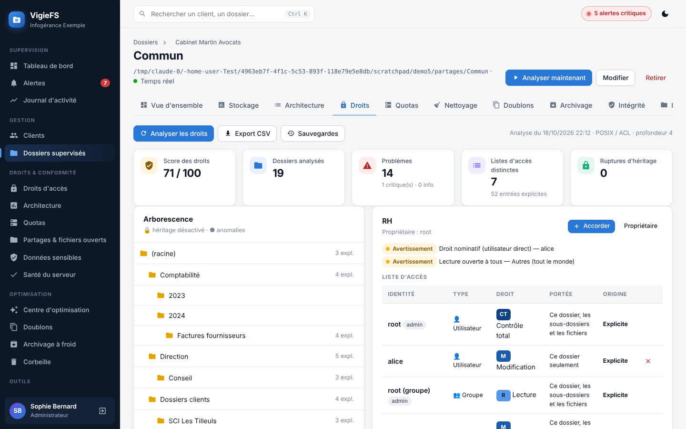 | 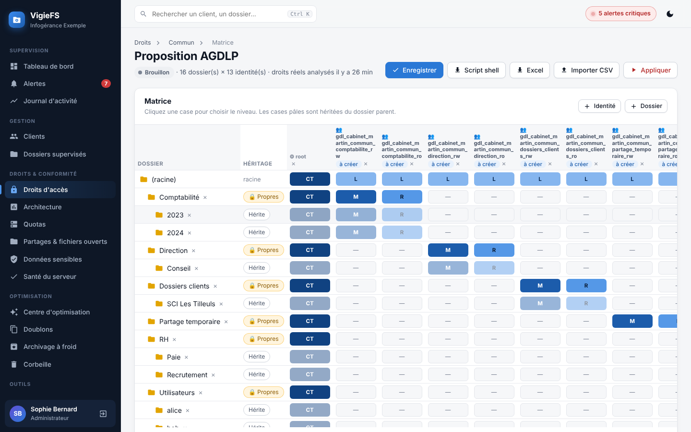 |

### Architecture, chemins et nommage
| Domaine | Ce que fait VigieFS |
|---|---|
| **Note d'architecture** | Note A à E sur 100 (structure, longueur des chemins, nommage, droits, hygiène) et **recommandations priorisées** avec lien vers l'action. |
| **Chemins trop longs** | Longueur vue par l'utilisateur (préfixe UNC / lecteur réseau configurable) : alerte au-delà de 240, critique au-delà de **260 (MAX_PATH)**, seuil **400 OneDrive / SharePoint**, nom de plus de 255 caractères. **Alerte en temps réel** dès qu'un fichier trop long est créé ou renommé. Export CSV des chemins. |
| **Nommage** | Caractères interdits (`" * : < > ? \ \|`), espaces en début ou fin, point final, noms réservés (CON, PRN, AUX, NUL, COM1…, LPT1…), noms bloqués par OneDrive / SharePoint (`.lock`, `desktop.ini`, `_vti_`, `~$`), conflits de casse. |
| **Structure** | Profondeur excessive, dossiers surchargés, fichiers à la racine, répartition par niveau, arborescence annotée (taille, fichiers, chemin maximal, ACL explicites, anomalies). |

### Quotas stricts, partages, santé, données sensibles
| Domaine | Ce que fait VigieFS |
|---|---|
| **Quotas stricts** | Quotas souples (alerte) ou **stricts** sur un dossier ou un sous-dossier, **quota automatique par sous-dossier** (dossiers personnels, projets), modèles. Application par **FSRM** (`New-FsrmQuota`, `New-FsrmAutoQuota`, seuils) quand il est présent, sinon **verrouillage VigieFS** : écriture refusée aux comptes non administrateurs dès le dépassement, rétablie automatiquement sous 98 %. Script FSRM généré. |
| **Partages SMB** | Partages et droits de partage, **fichiers ouverts** et **sessions** (fermeture / déconnexion), énumération basée sur l'accès (ABE) ; équivalents Samba (`smbstatus`). |
| **Santé du serveur** | SMB1, signature et chiffrement SMB, `LongPathsEnabled`, noms courts 8.3, volumes, clichés instantanés (VSS), audit d'accès aux fichiers, FSRM, services Datto, Defender / dossiers contrôlés, redémarrage en attente ; sous Linux : outils ACL, limites inotify, protocole et signature Samba, ABE, disques. |
| **Données sensibles (RGPD)** | NIR avec clé de contrôle, IBAN (ISO 7064), cartes bancaires (Luhn), mots de passe en clair, données de santé, listes d'e-mails / téléphones dans les documents (y compris Word, Excel, PowerPoint, OpenDocument) ; valeurs masquées, **croisement avec les droits** pour repérer les données exposées à tous. |

| Architecture d'un dossier | Quotas | Partages & fichiers ouverts |
|---|---|---|
| 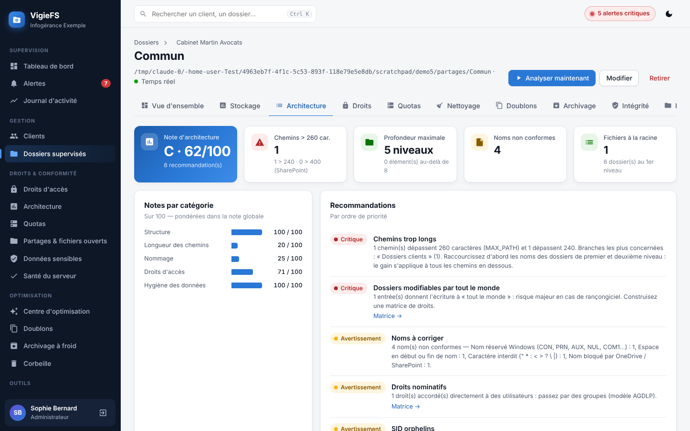 | 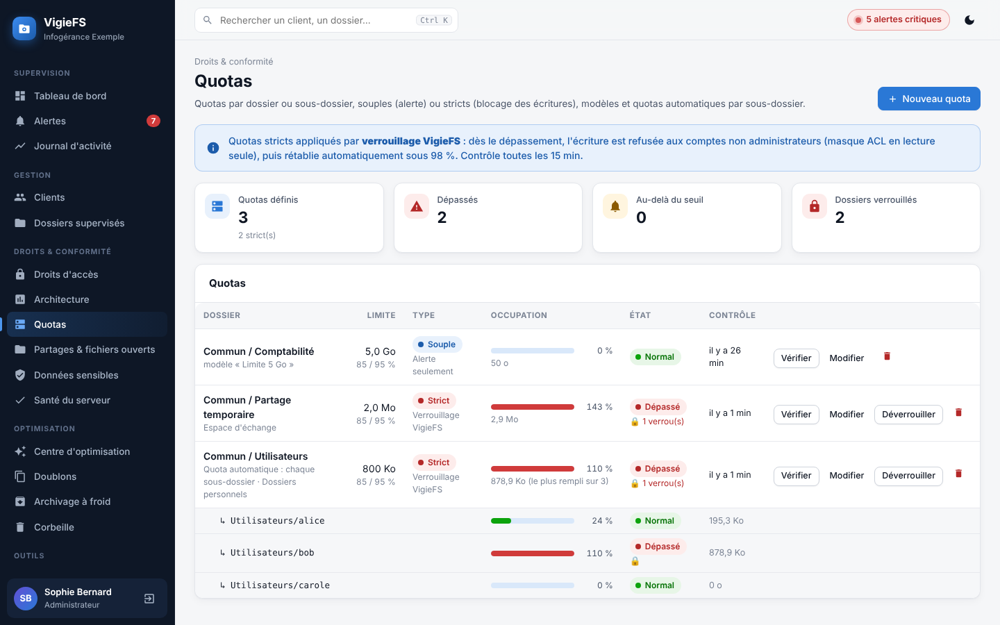 | 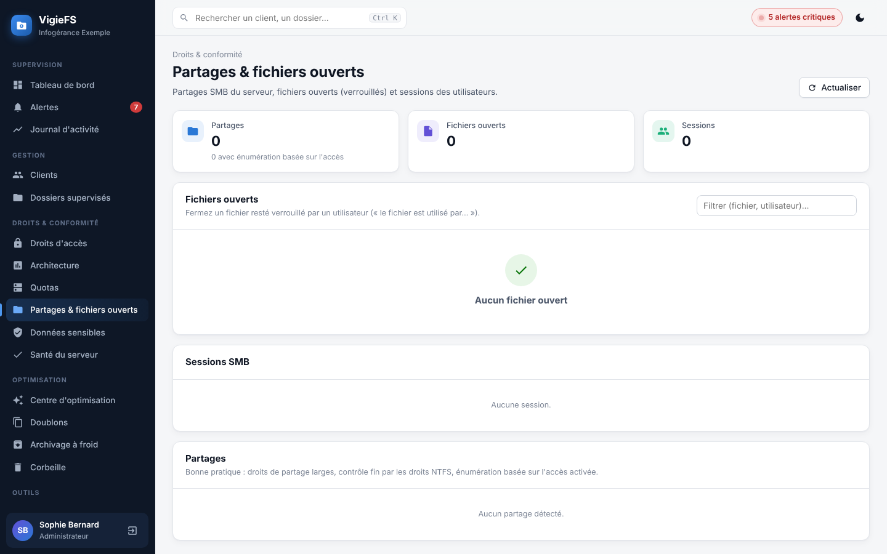 |

### Optimisation du stockage
| Domaine | Ce que fait VigieFS |
|---|---|
| **Centre d'optimisation** | Gain potentiel par client et par dossier : fichiers inutiles + doublons + données froides. |
| **Fichiers inutiles** | Détectés à chaque analyse : verrous Office orphelins (`~$…`), `.tmp`, téléchargements interrompus, `Thumbs.db`, `.DS_Store`, sauvegardes automatiques (`.bak`, `.wbk`, `.xlk`, `.asd`…), anciens journaux, fichiers vides, **dossiers vides**. Ancienneté minimale réglable pour ne jamais toucher un document ouvert. |
| **Doublons** | Comparaison du **contenu** (taille → empreinte partielle → SHA-256), dans un dossier ou **sur tous les dossiers d'un client**. Choix de l'exemplaire conservé (le plus ancien, le plus récent, chemin le plus court ou manuel) ; chaque copie est **revérifiée** avant suppression. |
| **Archivage à froid** | Règle par dossier (ancienneté, taille, extensions, exclusions, date de modification ou d'accès), **simulation** du gain, copie **vérifiée SHA-256** vers un NAS / disque d'archive en conservant les dates, **raccourci `[archivé]`** laissé à la place, restauration en un clic, planification automatique. |
| **Corbeille VigieFS** | Tout ce que VigieFS retire (nettoyage, doublons, suppression dans l'explorateur, remplacement par une version réparée) est **restaurable** pendant la durée de rétention, puis purgé automatiquement. |
| **Tâches** | Traitements longs en arrière-plan avec progression, annulation et historique. |

### Réparation de documents
| Domaine | Ce que fait VigieFS |
|---|---|
| **Diagnostic** | Word, Excel, PowerPoint (`.docx/.xlsx/.pptx` et variantes macro/modèle, anciens `.doc/.xls/.ppt`) et PDF : archive, XML, cohérence du paquet, liens internes, pages PDF. Détecte aussi les fichiers **remplis de zéros**, **chiffrés par un rançongiciel** ou **protégés par mot de passe** (non corrompus). |
| **Réparation Office** | Reconstruction de l'archive même si l'index est détruit ou le fichier tronqué, réparation XML (caractères invalides, balises non refermées, troncature), régénération des types de contenu et des relations, correction des liens cassés (images manquantes remplacées, références orphelines retirées), suppression des parties non essentielles endommagées (miniature, `calcChain.xml`…). |
| **Réparation PDF** | Données parasites retirées, fin de fichier restaurée, **table xref reconstruite**, **catalogue et arborescence des pages recréés** pour un PDF tronqué, pages illisibles remplacées par une page blanche (numérotation conservée). |
| **Anciens formats** | Conversion réparatrice via LibreOffice (si installé), sinon récupération du texte. |
| **Dernier recours** | Extraction du texte (Word/PowerPoint) ou des données (Excel) dans un nouveau document. |
| **Contrôle d'intégrité** | Analyse d'un dossier entier, liste des documents corrompus / irrécupérables, **réparation en lot** (copie « (réparé) » ou remplacement de l'original, mis en corbeille). |
| **Atelier** | Glisser-déposer d'un document reçu d'un client, téléchargement du fichier réparé, historique. |

Principes : l'original n'est jamais écrasé sans être conservé, chaque fichier réparé est **re-diagnostiqué** avant d'être proposé, et un fichier irrécupérable est signalé comme tel avec la marche à suivre (restauration Datto).

### Administration et intégration
Explorateur avec ACL NTFS, rôles (lecture seule / opérateur / administrateur), journal d'audit, API REST documentée (`/api/docs`), clés d'API, `/api/v1/status`, sondes `/api/health/live` et `/api/health/ready`, `/metrics` Prometheus, composant **Datto RMM**, rapports CSV par client.

| Centre d'optimisation | Nettoyage | Doublons |
|---|---|---|
| 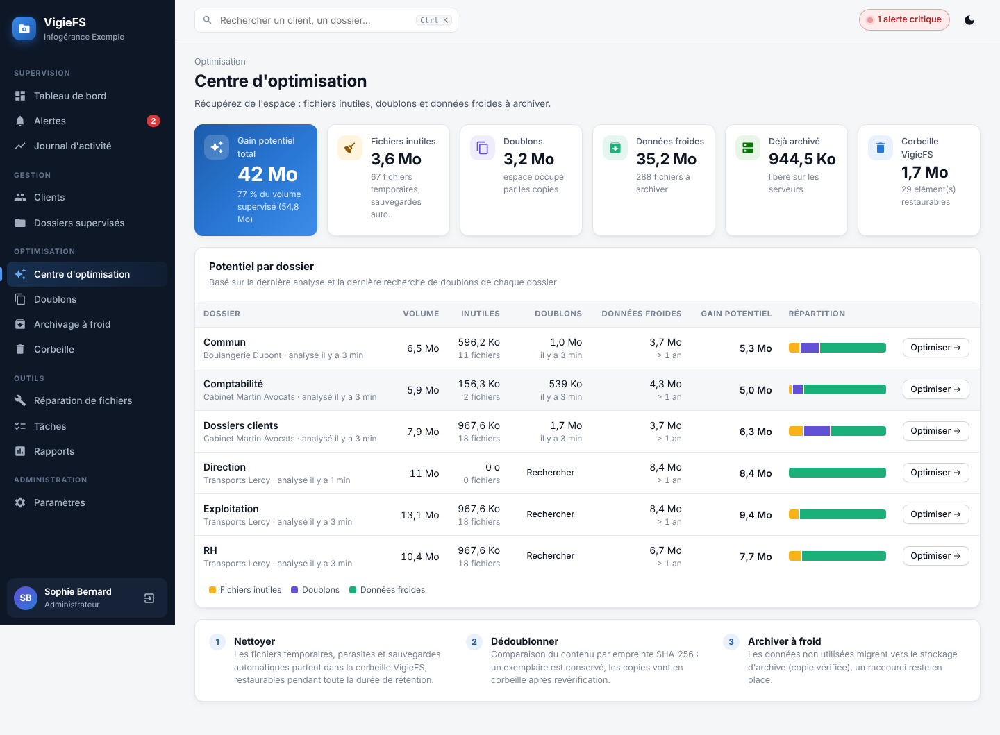 | 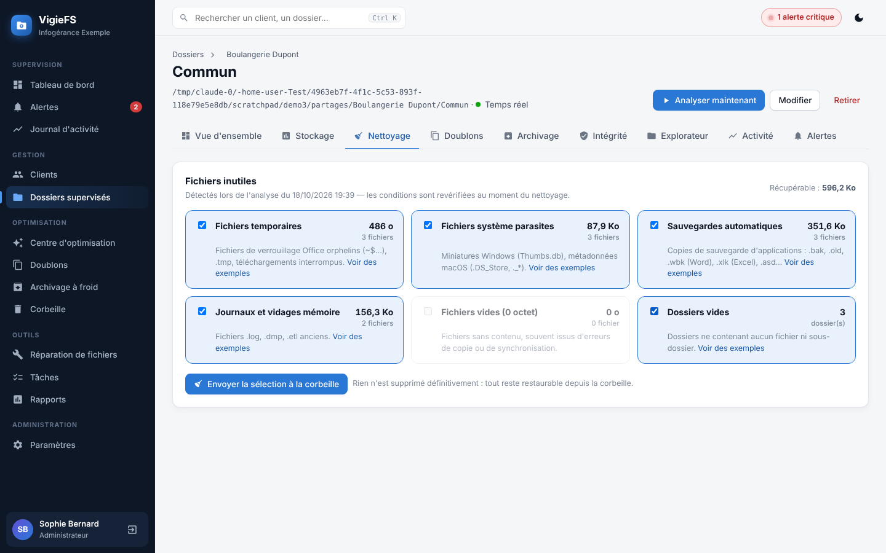 | 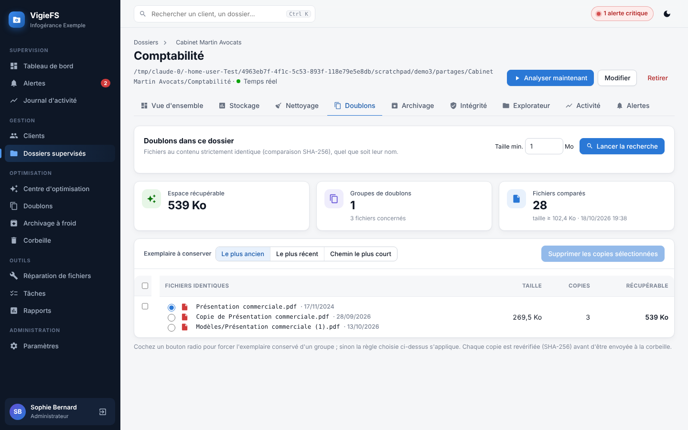 |

| Archivage à froid (simulation) | Contrôle d'intégrité | Diagnostic et réparation |
|---|---|---|
| 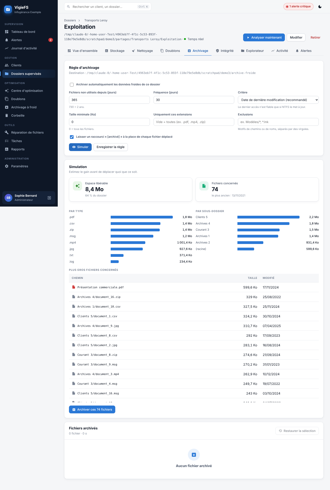 | 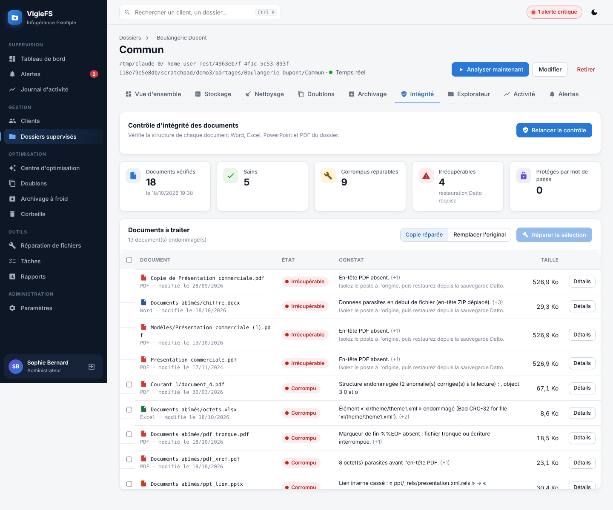 | 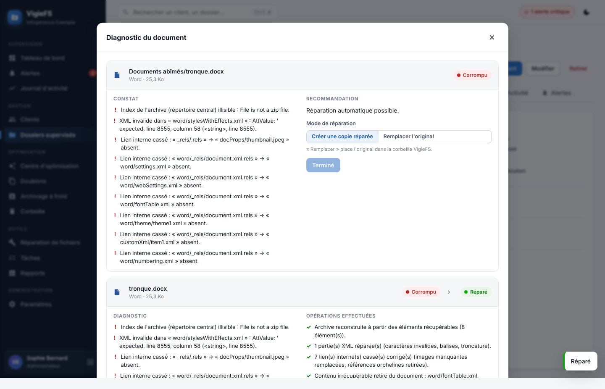 |

| Atelier de réparation | Thème sombre |
|---|---|
| 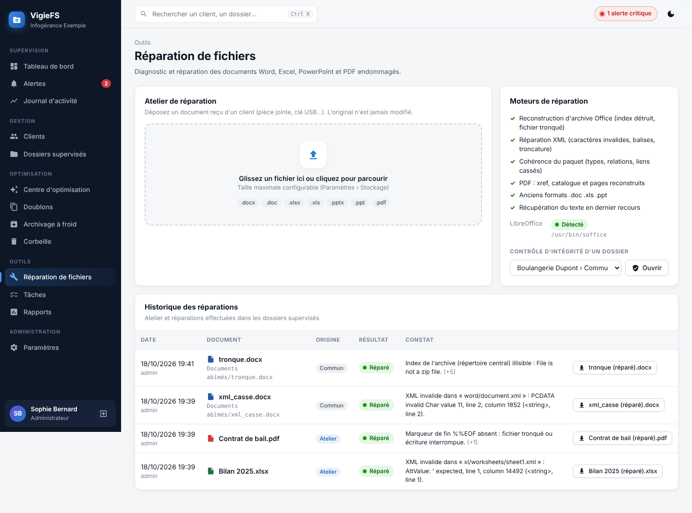 | 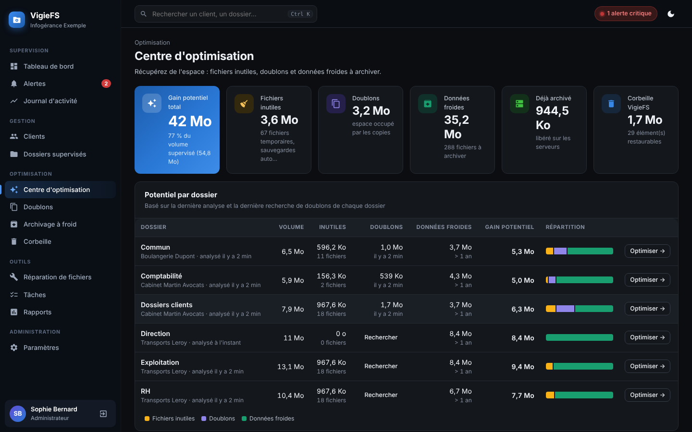 |

## Paquets Windows prêts à l'emploi

`python scripts/build-packages.py` fabrique deux archives autonomes : **Python 3.13 embarqué**
(paquet NuGet officiel de la Python Software Foundation) et bibliothèques incluses, donc rien à
installer et aucun accès Internet nécessaire sur la machine cible.

| Paquet | Pour | Lanceurs |
|---|---|---|
| `VigieFS-<version>-WindowsServer.zip` | Windows Server 2016 → 2025 : service 24 h/24 (WinSW inclus) | `INSTALLER-VigieFS.bat`, `DESINSTALLER-VigieFS.bat` |
| `VigieFS-<version>-PC-Windows.zip` | Windows 10 / 11 : essai ou usage sur un poste | `demo-vigiefs.bat`, `lancer-vigiefs.bat`, `arreter-vigiefs.bat` |

Chaque archive contient un `LISEZ-MOI.txt` pas à pas. Avant d'extraire : clic droit sur le ZIP ›
Propriétés › **Débloquer**.

## Installation sur Windows Server

**Avec le paquet Windows Server** : extrayez l'archive sur un disque local, double-cliquez sur
`INSTALLER-VigieFS.bat` et répondez aux questions (dossiers, port, accès réseau, compte de
service). Le programme est copié dans `C:\Program Files\VigieFS`, les données dans
`C:\ProgramData\VigieFS`, le service démarre et le navigateur s'ouvre ; un raccourci « VigieFS »
est posé sur le bureau. Relancer `INSTALLER-VigieFS.bat` depuis une version plus récente met à jour
sans toucher aux données.

**En ligne de commande** (PowerShell administrateur, depuis le dossier extrait) :

```powershell
.\scripts\install-windows.ps1 -DataDir 'D:\VigieFS\data' -Port 8470 -ListenAll `
    -ServiceAccount 'DOMAINE\svc-vigiefs' -ServicePassword '…'
```

- **Service Windows** via [WinSW](https://github.com/winsw/winsw) (inclus dans le paquet, sinon
  téléchargé ou fourni avec `-WinSWExe`), à défaut [NSSM](https://nssm.cc) s'il est dans le PATH,
  sinon tâche planifiée au démarrage + tâche de garde (`-Mode winsw|nssm|task` pour forcer).
  Démarrage automatique **différé**, actions de récupération du service (relance à 10 s, 30 s, 60 s).
- Depuis les sources (sans Python embarqué), le script crée un environnement `.venv` : Python 3.10
  à 3.13 et accès à PyPI requis.
- `-InstallDir` (défaut `C:\Program Files\VigieFS`) doit être un dossier dédié ; `-Uninstall`
  supprime le service et les tâches (programme et données conservés).
- Le compte de service doit pouvoir **lire** les dossiers supervisés (et **modifier** pour la
  quarantaine, l'explorateur, les quotas stricts et l'application des droits ; module
  ActiveDirectory pour créer les groupes). Pour des partages distants, préférez un compte de
  service du domaine (droit « Ouvrir une session en tant que service ») à SYSTEM.
- `-ListenAll` ouvre l'interface au réseau (et le port du pare-feu). Sinon elle n'écoute
  que sur `127.0.0.1`.

Au premier accès, l'écran **« Première installation »** crée le compte administrateur.

## Essayer VigieFS sur un poste (démonstration)

- **Windows** : avec le paquet PC, double-cliquez sur `demo-vigiefs.bat` (Python inclus). Depuis
  les sources, le même lanceur crée un environnement avec Python 3.10 à 3.13 s'il est installé.
- **macOS / Linux** : `./demo-vigiefs.sh` (Python 3.10 à 3.13 requis).

Le premier lancement crée un **jeu fictif** dans `data-demo/` et ouvre le navigateur sur
<http://localhost:8470/> ; créez le compte administrateur sur l'écran « Première installation ».
Le jeu fictif (≈ 8 Mo, deux clients) contient de quoi essayer chaque fonction : doublons,
fichiers inutiles, documents anciens à archiver, documents abîmés à réparer, un chemin de plus
de 260 caractères vu du réseau, des noms non conformes, un fichier interdit, des données
personnelles fictives (NIR, IBAN, carte, mot de passe, santé) et un quota dépassé. Les analyses
démarrent seules ; lancez ensuite *Analyser les droits*, *Proposition AGDLP*, *Doublons*,
*Contrôle d'intégrité* ou *Données sensibles* depuis chaque dossier.

`Ctrl+C` dans la fenêtre arrête VigieFS ; supprimer le dossier `data-demo` efface tout. Aucun
autre fichier du poste n'est lu ni modifié. Sur un poste, FSRM et Active Directory sont absents :
les quotas stricts passent par le verrouillage VigieFS et la création de groupes AD est indisponible.
`lancer-vigiefs.bat` lance VigieFS sur vos propres dossiers (dossier `data`).

### Linux (systemd)

```bash
sudo HOST=0.0.0.0 PORT=8470 DATA=/var/lib/vigiefs ./scripts/install-linux.sh
```

Installe le programme dans `/opt/vigiefs`, l'unité `vigiefs.service` (`Type=notify`,
`Restart=on-failure`, `WatchdogSec=120`, démarrage au boot) et relève les limites inotify
pour la surveillance de grandes arborescences. `--uninstall` pour retirer le service.
Le paquet `acl` (getfacl/setfacl) est requis pour la gestion des droits.

### Commandes

```
python -m vigiefs [serve]     interface + moteur, sans superviseur
python -m vigiefs supervise   mode 24 h/24 (utilisé par les services) : relance automatique
python -m vigiefs status      état, dernier incident, disponibilité sur 30 jours
python -m vigiefs stop        arrêt volontaire (--reason "…"), jamais relancé automatiquement
python -m vigiefs restart     redémarrage propre
python -m vigiefs restore-db  restaure la dernière sauvegarde saine de la base (--from FICHIER)
python -m vigiefs demo        jeu de démonstration fictif (dossier data-demo) puis lancement

Options : [--host 127.0.0.1] [--port 8470] [--data DOSSIER]
          [--ssl-certfile cert.pem --ssl-keyfile key.pem] [--reset-password UTILISATEUR]
          supervise : [--mode windows-service|systemd|…] [--hang-timeout 300]
```

`status` renvoie 0 si VigieFS tourne, 3 s'il a été arrêté volontairement, 1 s'il a été
interrompu sans arrêt volontaire (utilisable par un script de supervision).

Variables d'environnement équivalentes : `VIGIEFS_HOST`, `VIGIEFS_PORT`, `VIGIEFS_DATA`.
`VIGIEFS_FRAME_ANCESTORS` (ex. `https://supervision.exemple.fr`) autorise l'intégration
de l'interface en iframe dans votre centre de supervision.

Pour un accès hors du réseau d'administration, servez VigieFS en **HTTPS**
(`--ssl-certfile/--ssl-keyfile`) ou derrière un reverse proxy (IIS ARR, nginx…).

## Prise en main

1. **Clients** → *Nouveau client*.
2. **Dossiers supervisés** → *Ajouter un dossier* : client, chemin, quota, fréquence
   d'analyse, surveillance temps réel, filtrage. Une première analyse démarre aussitôt.
3. **Paramètres › Notifications** : SMTP (ex. `smtp.office365.com:587`) et/ou webhook
   (Teams, Slack, PSA, centre de supervision). Bouton *Envoyer un test*.
4. **Paramètres › Conformité** : seuils de longueur de chemin, préfixe des groupes
   (`GDL` par défaut) et unité d'organisation AD, modèles de quotas, données sensibles.
   **Paramètres › Sécurité & filtrage** : seuils anti-rançongiciel, extensions bloquées,
   dossier de quarantaine (**en dehors** des dossiers supervisés).
5. **Paramètres › Stockage & réparation** : dossier de la corbeille et rétention, destination
   des **archives à froid** (NAS, disque d'archive…), anciennetés minimales des fichiers inutiles,
   chemin de LibreOffice (optionnel, pour les anciens formats `.doc/.xls/.ppt`).
6. **Paramètres › Utilisateurs** : comptes des techniciens (rôle *Opérateur*) et des
   personnes en consultation (*Lecture seule*).
7. Sur chaque dossier : onglet **Droits** › *Analyser les droits*, puis *Proposition AGDLP*
   pour obtenir une matrice cible à ajuster, exporter (Excel) ou appliquer ; onglet
   **Architecture** pour la note et les chemins trop longs ; onglet **Quotas**.

### Rôles

| Rôle | Droits |
|---|---|
| Lecture seule | Consultation de tout (sauf paramètres), exports CSV. |
| Opérateur | + clients, dossiers, analyses, acquittement d'alertes, nettoyage, doublons, archivage et restauration, réparation, opérations sur les fichiers (suppressions vers la corbeille). |
| Administrateur | + application de matrices et modification de droits, restauration des droits, déverrouillage de quotas, fermeture de fichiers ouverts / sessions, arrêt, redémarrage et maintenance du service, purge définitive de la corbeille, suppression de clients, paramètres, utilisateurs, clés d'API, journal d'audit. |

## Intégration au centre de supervision (étape 2)

L'interface est entièrement construite sur l'API REST : le futur panneau de contrôle
du centre de supervision peut consommer exactement les mêmes points d'accès.

- **Documentation interactive** : `http://serveur:8470/api/docs` (OpenAPI).
- **Authentification machine** : créez une clé dans *Paramètres › Clés d'API* et
  envoyez-la dans `X-API-Key: vfs_…` ou `Authorization: Bearer vfs_…`.
- **Statut consolidé** (stable, versionné) :

  ```bash
  curl -H "X-API-Key: vfs_…" http://serveur:8470/api/v1/status
  ```
  ```json
  {"status": "critical", "alerts": {"critical": 1, "warning": 2, "info": 0},
   "service": {"status": "ok", "mode": "windows-service", "uptime_sec": 864000, "restarts": 1,
               "availability_30d": 99.998, "maintenance": null, "components": {"scheduler": "ok", "…": "ok"}},
   "shares": [{"client": "ACME", "name": "Compta", "status": "critical", "size": 123456,
               "quota_pct": 97.2, "monitoring": "active",
               "alerts": [{"severity": "critical", "category": "ransomware", "title": "…"}]}]}
  ```
- **Prometheus / Grafana** : `GET /metrics` (taille, fichiers, quota, disponibilité par
  dossier, alertes ouvertes par gravité, durée de fonctionnement, état des composants).
- **Sondes** sans authentification : `GET /api/health/live` (le processus répond) et
  `GET /api/health/ready` (200 si planificateur et composants sains, 503 sinon).
- **Webhook sortant** : `POST` JSON à chaque nouvelle alerte ou escalade, signé par
  `X-VigieFS-Signature: sha256=<HMAC-SHA256(corps, secret)>`.

### Datto RMM

`integrations/datto-rmm/VigieFS-Monitor.ps1` est un composant de type **Monitor** :

1. Datto RMM › *Components* › *New Component* › catégorie **Monitors**, script PowerShell,
   collez le contenu du fichier.
2. Déclarez les variables `VigieFSUrl`, `VigieFSApiKey` (clé *Lecture seule*),
   `AlertLevel` (`critical` ou `warning`) et, si besoin, `VigieFSData` (dossier de données)
   et `AlertOnPlannedStop` (`false` pour ne pas alerter sur un arrêt volontaire).
3. Ajoutez le monitor à la politique du serveur hébergeant VigieFS : une alerte Datto
   est levée dès que VigieFS signale un problème, qu'un composant du service est en erreur
   ou que VigieFS est injoignable (état du service Windows, arrêt volontaire, dernières
   lignes du journal en diagnostic). Pendant une maintenance déclarée, le monitor reste vert.

## Architecture

```
vigiefs/
├── vigiefs/
│   ├── __main__.py     Commandes serve / supervise / status / stop / restart / restore-db
│   ├── service.py      Superviseur 24 h/24, arrêt volontaire, journal de disponibilité
│   ├── guard.py        Garde interne : auto-réparation, battement de cœur, maintenance de la base
│   ├── demo.py         Jeu de démonstration fictif
│   ├── api.py          API REST FastAPI + service de l'interface
│   ├── api_rights.py   API droits, matrice, architecture, quotas, SMB, santé, RGPD
│   ├── api_service.py  API service : sondes, état, disponibilité, arrêt, maintenance
│   ├── engine.py       Planificateur, analyses, règles proactives, rétention
│   ├── acl.py          Relevé, audit et application des ACL NTFS / POSIX
│   ├── rights.py       Relevés de droits, dérive, sauvegarde / restauration des ACL
│   ├── matrix.py       Matrice de droits : AGDLP, plan d'écart, scripts, CSV / Excel
│   ├── pathcheck.py    Longueur des chemins, nommage, conflits
│   ├── structure.py    Note d'architecture et recommandations
│   ├── quotas.py       Quotas souples / stricts, FSRM, verrouillage VigieFS
│   ├── smb.py          Partages SMB / Samba, fichiers ouverts, sessions
│   ├── health.py       Contrôles de santé Windows Server / Linux
│   ├── sensitive.py    Données sensibles (RGPD)
│   ├── system.py       PowerShell, commandes, capacités de l'hôte
│   ├── jobs.py         Tâches de fond persistées (progression, annulation)
│   ├── optimize.py     Fichiers inutiles, nettoyage, doublons
│   ├── storage.py      Corbeille VigieFS, archivage à froid
│   ├── docrepair.py    Diagnostic et réparation Word / Excel / PowerPoint / PDF
│   ├── integrity.py    Contrôle d'intégrité d'un dossier, atelier de réparation
│   ├── monitor.py      Surveillance temps réel (watchdog), anti-rançongiciel
│   ├── scanner.py      Analyse d'arborescence, doublons, quarantaine
│   ├── alerts.py       Alertes (dédoublonnage, escalade) + e-mail / webhook
│   ├── rules.py        Quotas, prévisions, filtrage, sécurité des chemins
│   ├── permissions.py  ACL NTFS (icacls) / droits POSIX
│   ├── auth.py         Comptes, sessions, clés d'API
│   ├── db.py           SQLite (WAL)
│   └── static/         Interface web (HTML/CSS/JS natif en modules, aucune dépendance externe)
├── integrations/datto-rmm/VigieFS-Monitor.ps1
├── scripts/install-windows.ps1    Service Windows (WinSW / NSSM / tâche + garde)
├── scripts/build-packages.py      Paquets Windows Server / PC avec Python embarqué
├── packaging/                     LISEZ-MOI des paquets
├── scripts/install-linux.sh       Service systemd
├── scripts/vigiefs.service
├── INSTALLER-VigieFS.bat, DESINSTALLER-VigieFS.bat   Installation du service (double-clic)
├── lancer-vigiefs.bat, arreter-vigiefs.bat
├── demo-vigiefs.bat, demo-vigiefs.sh   Essai sur un poste avec le jeu fictif
└── tests/
```

Toutes les données (base SQLite, journaux applicatifs, sauvegardes de droits
`sauvegardes-acl/`, sauvegardes de base `sauvegardes-base/`, état du service `run/`) sont dans
le dossier `--data`. **Sauvegardez ce dossier** (ex. avec Datto). L'interface fonctionne hors ligne : aucune
ressource n'est chargée depuis Internet.

## Limites connues

- Sous Windows, les analyses lisent les chemins de plus de 260 caractères (préfixe `\\?\`) même
  sans `LongPathsEnabled` ; les actions sur ces fichiers (corbeille, archivage) peuvent échouer et
  sont alors signalées.
- Les parties propres à Windows (collecte `Get-Acl`, icacls, FSRM, cmdlets SMB, AD, contrôles de
  santé, service WinSW / NSSM) sont écrites d'après la documentation Microsoft mais testées ici
  sur des jeux de données simulés : **validez-les sur un serveur de recette** avant production.
  Le superviseur, la garde, les ACL POSIX, la matrice et les quotas sont testés de bout en bout
  sous Linux.
- Sans FSRM, le quota strict est appliqué par **verrouillage VigieFS** au contrôle suivant (toutes
  les 15 min par défaut) : un dépassement est possible entre deux contrôles. Sous Linux, le
  verrouillage passe par le masque ACL et empêche aussi la suppression ; préférez des quotas de
  système de fichiers (XFS project quotas, ZFS) pour un blocage instantané.
- Samba ne permet pas de fermer un fichier ouvert isolément (seule la session peut l'être).
- La détection de données sensibles est **heuristique** (motifs + clés de contrôle) : elle aide
  à prioriser, sans valeur de certification RGPD.
- Le superviseur ne survit pas à l'arrêt du serveur lui-même : c'est le service système qui
  relance VigieFS au démarrage ; une coupure brutale est journalisée comme « interruption ».
- La surveillance temps réel d'un partage UNC distant dépend du serveur distant
  (notifications SMB) ; les analyses planifiées restent la source de vérité.
- Le propriétaire NTFS n'est pas affiché (seules les ACL via `icacls`).
- La réparation de documents traite la corruption de **structure** (archive, XML, PDF). Un
  document dont le contenu a été écrasé (zéros, chiffrement) est irrécupérable : restaurez-le
  depuis Datto. Les documents protégés par mot de passe ne sont pas déchiffrés.
- Sans LibreOffice, les anciens formats binaires `.doc/.xls/.ppt` endommagés ne peuvent être
  récupérés qu'en texte brut.
- La corbeille et les archives doivent se trouver **hors** des dossiers supervisés ; pour des
  déplacements instantanés, placez la corbeille sur le même volume que les partages.

## Tests

```bash
pip install -r requirements-dev.txt
python -m pytest
```

## Références

Bonnes pratiques et limites prises en compte :

- Droits NTFS et modèle AGDLP : [tenfold — NTFS permissions](https://www.tenfold-security.com/en/set-ntfs-permissions),
  [Netwrix — NTFS permissions best practices](https://netwrix.com/en/resources/guides/ntfs-permissions-management-best-practices/),
  [Active Directory Pro — NTFS best practices](https://activedirectorypro.com/ntfs-permissions-management-best-practices),
  [Microsoft Tech Community — partages, NTFS et « Tout le monde »](https://techcommunity.microsoft.com/discussions/windowsserver/best-practices-sharing-folders-ntfsshare-permissions-and-the-everyone-permissiio/673125/replies/716094),
  [Active Directory Pro — rapport NTFS](https://docs.activedirectorypro.com/tools/security/ntfs-report),
  [NTFS Permissions Auditor — dépannage](https://albusbit.com/help/ntfs-permissions-auditor/troubleshooting.html),
  [icacls (Microsoft Learn)](https://learn.microsoft.com/windows-server/administration/windows-commands/icacls),
  [icacls — exemples](https://std.rocks/windows_icacls.html).
- Chemins longs et nommage : [WOSHub — limite MAX_PATH](https://woshub.com/max-path-length-limit-windows),
  [West Wind — chemins longs dans les applications Windows](https://weblog.west-wind.com/posts/2022/Jan/03/Integrating-Long-Path-Names-in-Windows-Applications),
  [Microsoft — restrictions OneDrive et SharePoint](https://support.microsoft.com/office/restrictions-and-limitations-in-onedrive-and-sharepoint-64883a5d-228e-48f5-b3d2-eb39e07630fa).
- Quotas et filtrage FSRM : [AWS FSx — gestion des quotas FSRM](https://docs.aws.amazon.com/fsx/latest/WindowsGuide/fsrm-quota-management.html),
  [AWS FSx — rapports FSRM](https://docs.aws.amazon.com/fsx/latest/WindowsGuide/fsrm-storage-reports.html),
  [Set-FsrmFileScreen (Microsoft)](https://technet.microsoft.com/itpro/powershell/windows/fileserverresourcemanager/set-fsrmfilescreen).
- Partages SMB : [WOSHub — gérer les partages en PowerShell](https://woshub.com/manage-windows-file-shares-with-powershell/),
  [Get-SmbServerConfiguration (Microsoft Learn)](https://learn.microsoft.com/it-it/powershell/module/smbshare/get-smbserverconfiguration),
  [smbstatus (Samba)](https://manpages.ubuntu.com/manpages/jammy/man1/smbstatus.1.html).
- Données sensibles : [composition du numéro de sécurité sociale](https://www.aide-sociale.fr/composition-numero-securite-sociale/),
  [Varonis — Data Risk Report](https://info.varonis.com/hubfs/docs/research_reports/2017-data-risk-report.pdf).
- Fonctionnement en service : [WinSW](https://github.com/winsw/winsw), [NSSM](https://nssm.cc),
  [systemd.service](https://www.freedesktop.org/software/systemd/man/latest/systemd.service.html),
  [sd_notify](https://www.freedesktop.org/software/systemd/man/latest/sd_notify.html).
