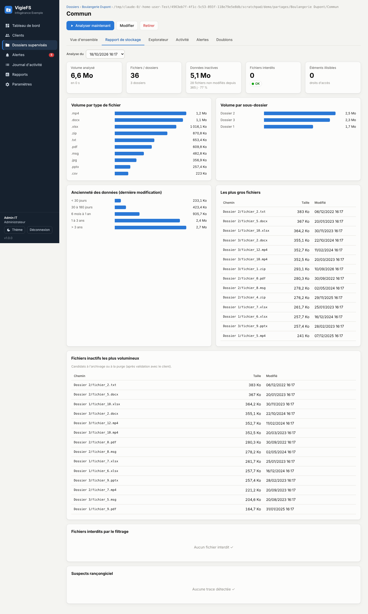
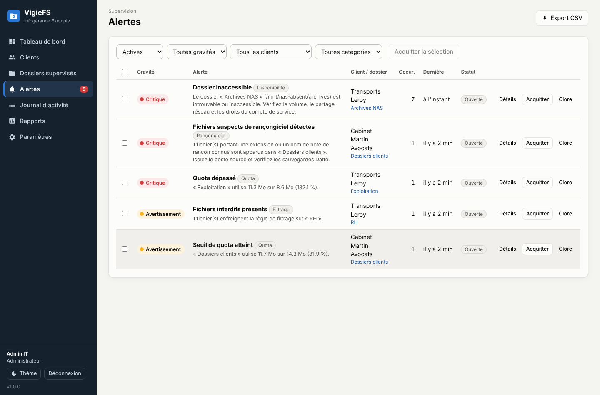
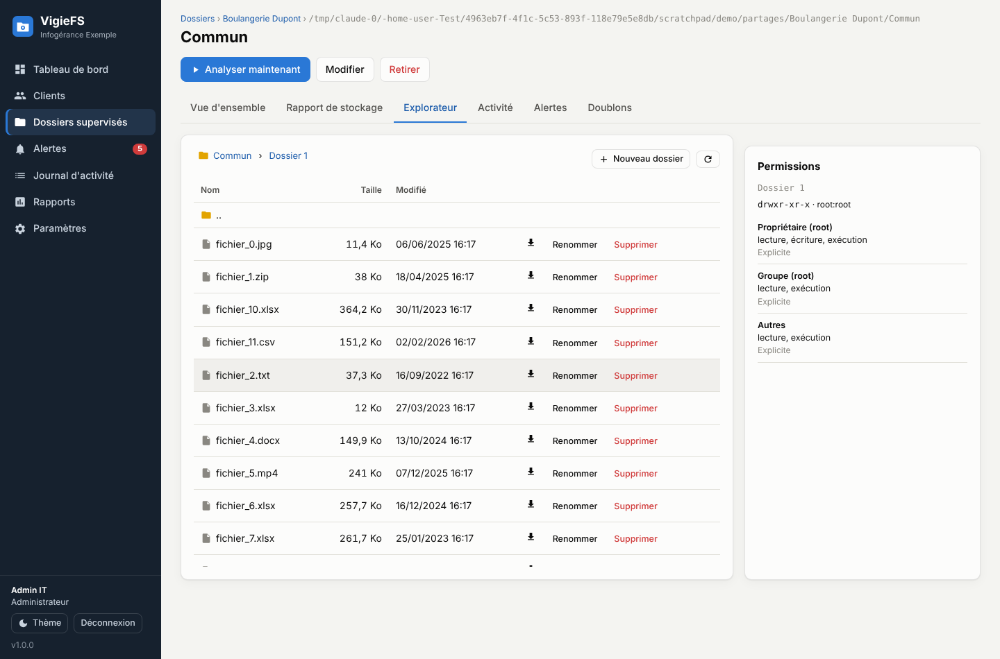

# VigieFS — supervision et administration de serveurs de fichiers

Console web de **supervision, d'administration et de prévention** pour les dossiers et
partages de fichiers de vos clients, dans l'esprit du *Gestionnaire de ressources du
serveur de fichiers* (FSRM) de Windows Server, mais pensée **multi-clients** pour une
société d'infogérance. Elle complète Datto (sauvegarde / RMM) sans le remplacer.


## Fonctionnalités

| Domaine | Ce que fait VigieFS |
|---|---|
| **Multi-clients** | Clients → dossiers supervisés (chemins locaux `D:\…` ou UNC `\\SRV\partage`). Vue consolidée et par client. |
| **Quotas** | Quota logiciel par dossier, seuils d'avertissement / critique, jauges, alertes, **prévision de saturation** (tendance sur 30 jours). |
| **Rapports de stockage** | Volume par type de fichier, par sous-dossier, ancienneté, plus gros fichiers, **données inactives** (candidates à l'archivage), historique et courbe d'évolution, doublons (SHA-256). |
| **Filtrage de fichiers** | Extensions interdites (globales ou par dossier), alerte ou **mise en quarantaine** automatique, en temps réel et lors des analyses. |
| **Anti-rançongiciel** | Détection temps réel des extensions chiffrées connues, des notes de rançon et des **rafales de modifications** (comportement de chiffrement) → alerte critique immédiate. |
| **Journal d'activité** | Créations, modifications, suppressions, renommages en temps réel (watchdog), filtrable, export CSV. |
| **Disponibilité** | Dossier/partage inaccessible, espace libre du volume trop bas → alertes avec résolution automatique. |
| **Alertes** | Dédoublonnées, escalade, acquittement (individuel / groupé), clôture, résolution automatique quand la cause disparaît. Notifications **e-mail (SMTP)** et **webhook** signé HMAC. |
| **Explorateur** | Navigation, création de dossier, renommage, téléchargement, suppression (admin), **lecture des ACL NTFS** (icacls) ou des droits POSIX. |
| **Sécurité** | Comptes avec rôles (lecture seule / opérateur / administrateur), mots de passe PBKDF2, verrouillage anti force brute, protection CSRF, **journal d'audit** de toutes les actions. |
| **Intégration** | API REST documentée (`/api/docs`), clés d'API, `/api/v1/status` pour le centre de supervision, `/metrics` Prometheus, composant **Datto RMM** prêt à l'emploi. |
| **Rapports** | Consommation par client (facturation du stockage) et historique des alertes en CSV (compatible Excel). |

| Rapport de stockage | Alertes | Explorateur + ACL |
|---|---|---|
|  |  |  |

## Installation sur Windows Server

Prérequis : **Python 3.10+** (cocher « Add python.exe to PATH » à l'installation).

**Essai rapide** : double-cliquez sur `start-vigiefs.bat`, puis ouvrez <http://localhost:8470/>.

**Installation permanente** (PowerShell administrateur, depuis le dossier `vigiefs`) :

```powershell
.\scripts\install-windows.ps1 -DataDir 'D:\VigieFS\data' -Port 8470 -ListenAll `
    -ServiceAccount 'DOMAINE\svc-vigiefs' -ServicePassword '…'
```

- Avec [NSSM](https://nssm.cc) dans le PATH, VigieFS devient un **service Windows** ;
  sinon une tâche planifiée « au démarrage » est créée.
- Le compte de service doit pouvoir **lire** les dossiers supervisés (et **modifier**
  pour la quarantaine et l'explorateur). Pour des partages distants, préférez un compte
  de service du domaine à SYSTEM.
- `-ListenAll` ouvre l'interface au réseau (et le port du pare-feu). Sinon elle n'écoute
  que sur `127.0.0.1`.

Au premier accès, l'écran **« Première installation »** crée le compte administrateur.

### Linux / autre

```bash
python3 -m venv .venv && . .venv/bin/activate
pip install -r requirements.txt
python -m vigiefs --host 0.0.0.0 --port 8470 --data /var/lib/vigiefs
```

### Options

```
python -m vigiefs [--host 127.0.0.1] [--port 8470] [--data DOSSIER]
                  [--ssl-certfile cert.pem --ssl-keyfile key.pem]
                  [--reset-password UTILISATEUR]
```

Variables d'environnement équivalentes : `VIGIEFS_HOST`, `VIGIEFS_PORT`, `VIGIEFS_DATA`.
`VIGIEFS_FRAME_ANCESTORS` (ex. `https://supervision.exemple.fr`) autorise l'intégration
de l'interface en iframe dans votre centre de supervision.

Pour un accès hors du réseau d'administration, servez VigieFS en **HTTPS**
(`--ssl-certfile/--ssl-keyfile`) ou derrière un reverse proxy (IIS ARR, nginx…).

## Prise en main

1. **Clients** → *Nouveau client*.
2. **Dossiers supervisés** → *Ajouter un dossier* : client, chemin, quota, fréquence
   d'analyse, surveillance temps réel, filtrage. Une première analyse démarre aussitôt.
3. **Paramètres › Notifications** : SMTP (ex. `smtp.office365.com:587`) et/ou webhook
   (Teams, Slack, PSA, centre de supervision). Bouton *Envoyer un test*.
4. **Paramètres › Sécurité & filtrage** : seuils anti-rançongiciel, extensions bloquées,
   dossier de quarantaine (**en dehors** des dossiers supervisés).
5. **Paramètres › Utilisateurs** : comptes des techniciens (rôle *Opérateur*) et des
   personnes en consultation (*Lecture seule*).

### Rôles

| Rôle | Droits |
|---|---|
| Lecture seule | Consultation de tout (sauf paramètres), exports CSV. |
| Opérateur | + clients, dossiers, analyses, acquittement d'alertes, création / renommage / téléchargement de fichiers. |
| Administrateur | + suppression de fichiers et de clients, paramètres, utilisateurs, clés d'API, journal d'audit. |

## Intégration au centre de supervision (étape 2)

L'interface est entièrement construite sur l'API REST : le futur panneau de contrôle
du centre de supervision peut consommer exactement les mêmes points d'accès.

- **Documentation interactive** : `http://serveur:8470/api/docs` (OpenAPI).
- **Authentification machine** : créez une clé dans *Paramètres › Clés d'API* et
  envoyez-la dans `X-API-Key: vfs_…` ou `Authorization: Bearer vfs_…`.
- **Statut consolidé** (stable, versionné) :

  ```bash
  curl -H "X-API-Key: vfs_…" http://serveur:8470/api/v1/status
  ```
  ```json
  {"status": "critical", "alerts": {"critical": 1, "warning": 2, "info": 0},
   "shares": [{"client": "ACME", "name": "Compta", "status": "critical", "size": 123456,
               "quota_pct": 97.2, "monitoring": "active",
               "alerts": [{"severity": "critical", "category": "ransomware", "title": "…"}]}]}
  ```
- **Prometheus / Grafana** : `GET /metrics` (taille, fichiers, quota, disponibilité par
  dossier, alertes ouvertes par gravité).
- **Webhook sortant** : `POST` JSON à chaque nouvelle alerte ou escalade, signé par
  `X-VigieFS-Signature: sha256=<HMAC-SHA256(corps, secret)>`.

### Datto RMM

`integrations/datto-rmm/VigieFS-Monitor.ps1` est un composant de type **Monitor** :

1. Datto RMM › *Components* › *New Component* › catégorie **Monitors**, script PowerShell,
   collez le contenu du fichier.
2. Déclarez les variables `VigieFSUrl`, `VigieFSApiKey` (clé *Lecture seule*) et
   `AlertLevel` (`critical` ou `warning`).
3. Ajoutez le monitor à la politique du serveur hébergeant VigieFS : une alerte Datto
   est levée dès que VigieFS signale un problème, avec le détail en diagnostic.

## Architecture

```
vigiefs/
├── vigiefs/
│   ├── api.py          API REST FastAPI + service de l'interface
│   ├── engine.py       Planificateur, analyses, règles proactives, rétention
│   ├── monitor.py      Surveillance temps réel (watchdog), anti-rançongiciel
│   ├── scanner.py      Analyse d'arborescence, doublons, quarantaine
│   ├── alerts.py       Alertes (dédoublonnage, escalade) + e-mail / webhook
│   ├── rules.py        Quotas, prévisions, filtrage, sécurité des chemins
│   ├── permissions.py  ACL NTFS (icacls) / droits POSIX
│   ├── auth.py         Comptes, sessions, clés d'API
│   ├── db.py           SQLite (WAL)
│   └── static/         Interface web (HTML/CSS/JS natif, aucune dépendance externe)
├── integrations/datto-rmm/VigieFS-Monitor.ps1
├── scripts/install-windows.ps1
└── tests/
```

Toutes les données (base SQLite, journaux applicatifs) sont dans le dossier `--data`.
**Sauvegardez ce dossier** (ex. avec Datto). L'interface fonctionne hors ligne : aucune
ressource n'est chargée depuis Internet.

## Limites connues

- Les quotas sont **logiciels** : VigieFS alerte et prévoit, mais ne bloque pas l'écriture
  (pour un blocage strict, combinez avec un quota FSRM / NTFS).
- La surveillance temps réel d'un partage UNC distant dépend du serveur distant
  (notifications SMB) ; les analyses planifiées restent la source de vérité.
- Le propriétaire NTFS n'est pas affiché (seules les ACL via `icacls`).

## Tests

```bash
pip install -r requirements-dev.txt
python -m pytest
```
